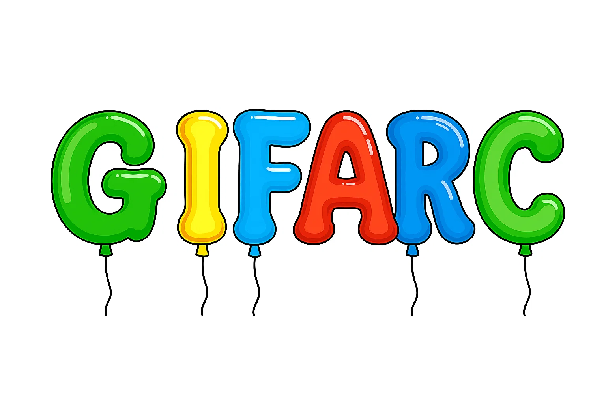
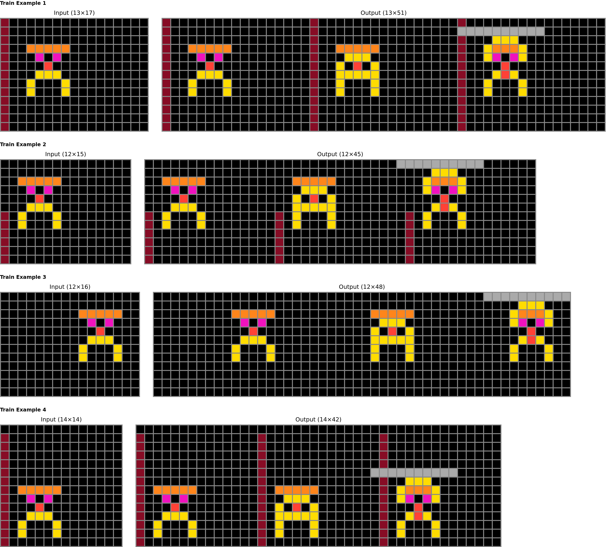

# GIFARC: A GIF-Derived Resource for Analogy-Guided Task Framing



GIFARC contains **1,614 ARC-style tasks** with **17,010 stored input/output pairs**, derived from GIF-inspired task sketches. Each task combines an analogical task frame, executable generation/transformation code, and grid examples. It is a resource for studying how task framing appears in model-generated rule descriptions, how support components affect solving, and how GIFARC transfers to ARC-AGI.

The paper finds modestly greater metaphorical wording and reference-frame alignment in emitted `inferred_rule` descriptions. These descriptions are model outputs; the analyses do not measure internal reasoning. Solving effects depend on the model, support components, and metric; matched wording comparisons show no consistent solving advantage for metaphorical wording. Supervised fine-tuning reaches up to 6.4% ARC-AGI-1 exact match and improves ARC-AGI-2 cell-level metrics, while ARC-AGI-2 exact match remains zero. In-context results are mixed across exact match, grid-cell accuracy, and foreground accuracy.

GIFARC includes grids beyond ARC's 30×30 bound: **798 tasks** have every stored input and output within 30 rows and 30 columns; **3,160 input grids** and **5,578 output grids** exceed that bound. These counts describe stored examples, without executing task programs.



## Inspect the review artifacts

This Software supplement preserves the original generation pipeline and adds the actual alignment/evaluation helper definitions, offline filtering, saved-metric reaggregation, and a compact ICL human-review sample. The [Data supplement](Data/README.md) contains `Data/data/data.jsonl` and `Data/data/alignment_scores.jsonl`. Raw source GIFs, original crawl metadata, private logs, checkpoints, and source GIF URLs are not distributed here.

The Data rows retain `source`, `examples`, and `seeds`, and add `task_id` and `alignment`:

```json
{
  "task_id": 240,
  "source": "<Python program>",
  "examples": [["<input grid>", "<output grid>"]],
  "seeds": ["<upstream seed filename>", "<concepts and description>"],
  "alignment": {
    "score": 0.51,
    "status": "scored",
    "unscored_reason": null
  }
}
```

This is a schema illustration, not an actual score for task 240. `task_id` is the canonical **one-based original identity**, independent of JSONL row order. The `seeds` list contains generation provenance and a final concepts/description entry; it is not a list of random-number seeds. Unscored records use `score: null`, `status: "unscored"`, and the verified failure reason. The release does not contain a `url` field and does not establish a unique-GIF count from its task count.

## Offline checks and filtering

Python 3.11 is sufficient for filtering and cached-result aggregation; these commands need no provider credentials. Run from this repository root. For ARR ZIPs, extract Data and Software beside each other and run from Software, using `../Data/` instead of `Data/`:

```bash
python reproducibility/filter_alignment.py --help
python reproducibility/filter_alignment.py \
  --data Data/data/data.jsonl \
  --scores Data/data/alignment_scores.jsonl \
  --tau 0.45 --output results/filtered_ge_045.jsonl
python reproducibility/reaggregate_results.py \
  --scores Data/data/alignment_scores.jsonl \
  --output-dir results/alignment_reaggregation
python reproducibility/summarize_trace_margin.py --output results/trace_margin.csv
python reproducibility/summarize_icl_review.py
```

Filtering retains `score >= tau`, excludes null scores, checks the sidecar source hashes, and copies selected original lines without rounding. It never executes task source. The five thresholds 0.45/0.50/0.55/0.60/0.65 retain 987/622/319/129/39 tasks, respectively, from 1,608 scored tasks; six unscored tasks are excluded. Reaggregation uses compact metrics from existing runs, keeps the original supports fixed, and reports metric-specific valid denominators.

Usage Ratio is the proportion of detected **word tokens tagged as metaphorical** in an emitted rule description. Similarity is the embedding cosine similarity between that description and its reference GIFARC task frame. Existing `trace_*` filenames are retained for compatibility and refer to this rule-description analysis. GIFARC SFT jointly supervises task frames, solution code, and output grids; its transfer gains do not isolate task framing.

[Reproducibility documentation](docs/REPRODUCIBILITY.md) describes the actual scoring settings, aggregation conventions, limitations, and included source provenance. [ICL review documentation](docs/ICL_ERROR_ANALYSIS.md) describes the nine-label taxonomy and the fixed sample of 26 human-reviewed incorrect responses.

## Generate tasks from your own GIFs

Install the original generation dependencies using [SETUP.md](docs/SETUP.md), place GIF files you can use under `data/GIF/`, and run `description_executor.ipynb`. See [GENERATION.md](docs/GENERATION.md). Model-backed generation requires your own provider configuration. The original generation implementation and timeout defaults are preserved; the notebook explicitly supplies `--total_timeout 300`.

The review bundle supports local generation with user-provided GIFs. It does not reproduce the paper's original GIF crawling stage or certify that a newly generated task has adequate conceptual alignment.

## Structure

```text
README.md
LICENSE
AGENTS.md
Data/                        processed tasks, alignment metadata, and dataset documentation
description_executor.ipynb
src/                         original generation code, prompts, and seed programs
data/GIF/                    local input GIF directory
docs/                        setup, generation, reproducibility, and provenance
reproducibility/             copied scientific helpers and offline release adapters
reproducibility/summaries/   compact saved metrics and reviewed sample
```

## Citation and license

```bibtex
@misc{anonymous2026gifarc,
  title={GIFARC: A GIF-Derived Resource for Analogy-Guided Task Framing},
  author={Anonymous Authors},
  note={Under review},
  year={2026}
}
```

The original software is distributed under the [MIT License](LICENSE). Consult the [Data supplement](Data/DATA_LICENSE.md) for its data terms and [Third-Party Notices](docs/THIRD_PARTY_NOTICES.md) for seed-program provenance and unresolved upstream licensing details. The software license does not grant rights to third-party GIFs, benchmark datasets, or model services.
